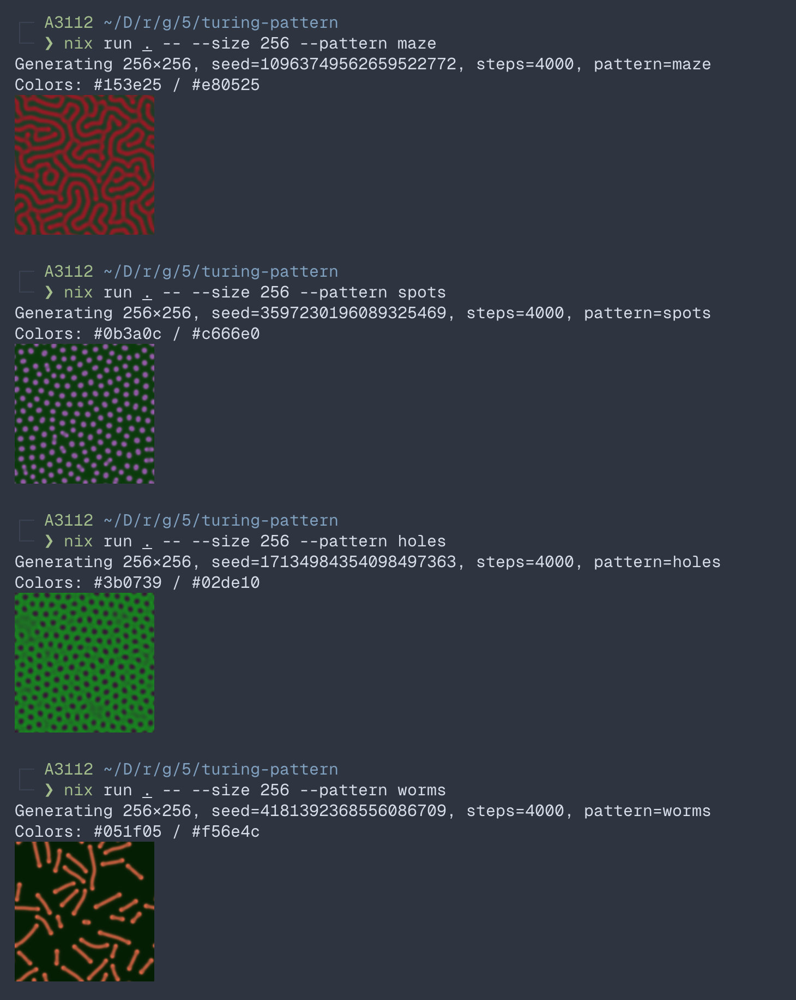

# turing-pattern

Gray–Scott反応拡散モデルでチューリングパターンを生成し、[chafa](https://hpjansson.org/chafa/) でターミナルに表示するCLI  

  

## 使い方
```sh
nix run .                                  # 512×512、すべてランダム
nix run . -- --size 256 --pattern worms    # サイズと模様を指定
nix run . -- --seed 42                     # 同じ模様・配色を再現
```

| 引数 | 既定値 | 内容 |
| --- | --- | --- |
| `--size` | `512` | 一辺のピクセル数 |
| `--seed` | ランダム | 0〜2⁶⁴−1。模様の種類・配色・形がすべて決まる |
| `--steps` | `4000` | シミュレーションの更新回数 |
| `--pattern` | seedで決定 | 模様の種類（下表） |

seed・模様の種類・配色は標準エラー出力に表示される

## 模様の種類
| 種類 | 見た目 | F | k |
| --- | --- | --- | --- |
| `coral` | 珊瑚状に曲がりくねる帯 | 0.0545 | 0.062 |
| `maze` | 細かく入り組んだ迷路 | 0.029 | 0.057 |
| `spots` | 等間隔に並ぶ斑点 | 0.0367 | 0.0649 |
| `holes` | 斑点を反転したような穴 | 0.039 | 0.058 |
| `worms` | 離れて伸びる短い線 | 0.058 | 0.065 |

## 開発
Nix（flakes有効）・direnv・nix-direnvを使用
```sh
direnv allow
cargo run --release -- --size 256    # 作業ツリーを直接実行
```

テスト
```sh
cargo test --release
cargo run --release --example bench    # サイズごとの計算時間
nix flake check                         # ビルド時のテストと実行確認
```

## 仕組み
- 濃度`u`・`v`を前進Euler法（Δt=1）で更新。拡散係数は`Du=1.0`・`Dv=0.5`、Laplacianは9点ステンシル、境界は周期境界
- Rustで実装。2つのバッファを交互に使い、端以外はSIMDで計算できる形にしている
- 一辺256ピクセル以上ではrayonで行ごとに複数のCPUコアへ分配
- 高速版の結果は、テスト内の素直な参照実装とビット単位で一致
- 模様の種類・配色・初期配置はseedから別々の乱数（xoshiro256++）で決めるので、互いに影響しない

| ファイル | 内容 |
| --- | --- |
| `src/sim.rs` | シミュレーションと模様の種類 |
| `src/render.rs` | 配色・描画・PNG変換 |
| `src/display.rs` | chafaでの表示 |
| `src/rng.rs` | 乱数 |
| `src/main.rs` | 引数の処理 |

計算時間の目安（Apple Silicon 10コア、4000ステップ）
| 一辺 | 時間 |
| --- | --- |
| 256 | 0.13秒 |
| 512 | 0.42秒 |
| 1024 | 0.7秒 |
| 2048 | 4.4秒 |

## 参考資料
- [Gray–Scottモデル — MIT CSAIL](https://groups.csail.mit.edu/mac/projects/amorphous/GrayScott/)
- [Reaction-Diffusion Tutorial — Karl Sims](https://karlsims.com/rd.html)
- [xoshiro / xorshift generators](https://prng.di.unimi.it/)
- [Rayon](https://docs.rs/rayon)
